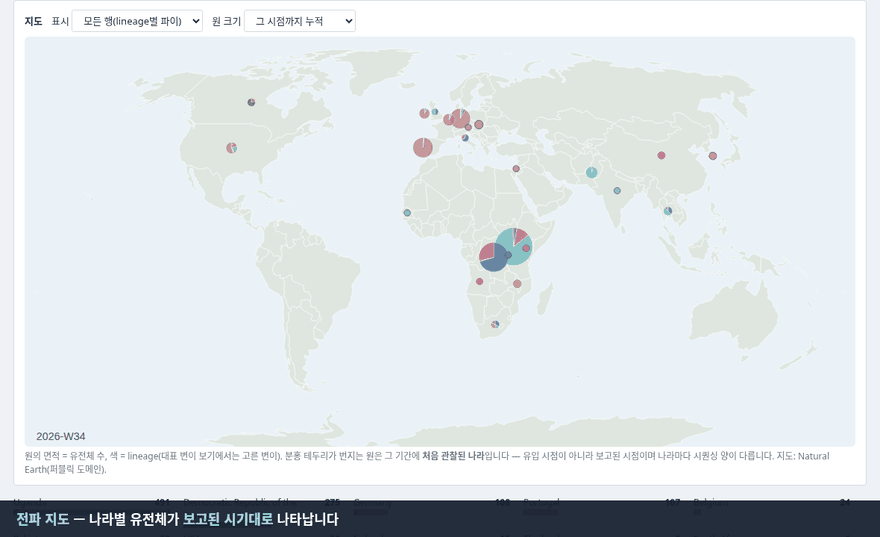
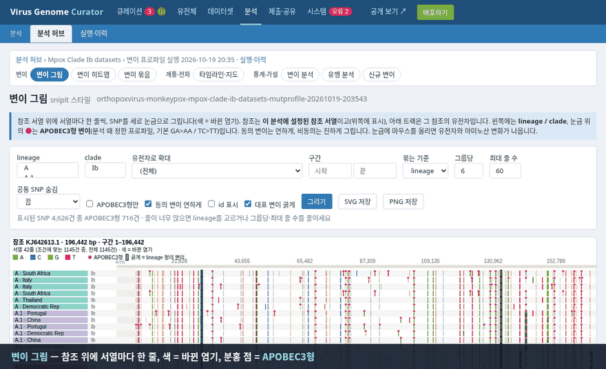
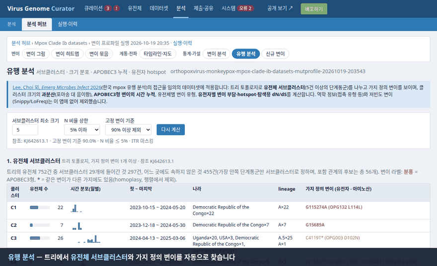
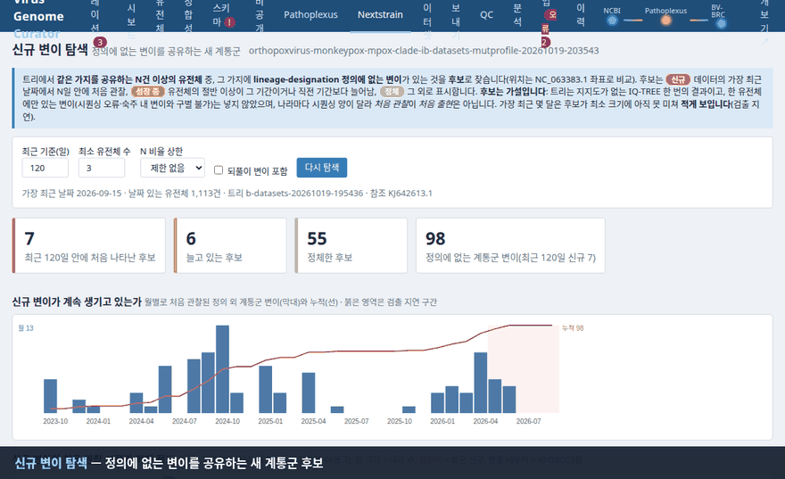

# Virus Genome Metadata Curator

[](https://github.com/CHOICHI-HWAN/GenomeCurator/actions/workflows/ci.yml)


[한국어](README.ko.md)

A local web tool that collects **virus** genome metadata from [NCBI Virus](https://www.ncbi.nlm.nih.gov/labs/virus/), [BV-BRC](https://www.bv-brc.org/) and [Pathoplexus](https://pathoplexus.org/), compares what the three sources say about the same genome, and adds records to your database only after you have approved them. Package and command name: `genomecurator`.

It is for viruses only. Bacteria differ in record structure (multi-contig assemblies) and sequence size, and will be a separate project.

## Features

### Curation: collect, compare, approve

1. **Nothing changes without approval.** New and changed records collect as a *changeset*; only what you approve and apply reaches your data. Rejected items do not come back.
2. **Three sources, one record.** NCBI Virus defines which accessions exist; Pathoplexus > NCBI > BV-BRC decide each field, and every value keeps a record of the source it came from.
3. **Agreement between sources is measured.** Per field: match / notation difference (`2022-07` vs `2022-07-11`) / real conflict.
4. **Sequence verification.** Disagreements can be settled by comparing the sequence body (SHA-256, headers removed), with a dry-run first so large downloads are avoided.
5b. **Our own term dictionary.** Hosts, countries, collection dates and clades are standardised against the app's dictionary before the sources are compared (`Homosapiens` -> `Homo sapiens`, `Zaire` -> `Democratic Republic of the Congo`, date intervals); unknown or doubtful values are kept and flagged, and the raw value is always recorded.
5. **Choose between sources' values**, with a suggested value, the reason and a confidence level; choices survive later checks.
6. **Schema watch.** Detects when a source renames or removes a field your adapters read, daily and on demand.
7. **Genome completeness classes**: Complete / Near complete (≥ 90% of the longest RefSeq genome, adjustable) / Partial.
8. **Jobs tab.** Every long task runs on the server with status, progress, log and error; it survives page changes and restarts.

### Quality, private genomes and datasets

9. **Sequence QC.** Sequence statistics (length, N and ambiguity, GC) for every genome, and [Nextclade](https://github.com/nextstrain/nextclade) clade/lineage plus its quality score for viruses that have a Nextclade dataset (mpox, Ebola species, measles, dengue, ...). A clade that differs from the sources goes to the review screen instead of being overwritten; datasets are updated from a button.
10. **Export for other programs.** Aligned `metadata.tsv` + `sequences.fasta` (+ manifest with checksums) from a tab, the CLI or an internal API, with a profile that matches the [Nextstrain mpox](https://github.com/nextstrain/mpox) workflow's input columns.
11. **Private store.** Local, unpublished genomes are uploaded one at a time or from a spreadsheet (template included; every upload is a version; dry run first) into a store separate from the public set and exported as *separate files* wired to the Nextstrain workflow's own `private_metadata` / `private_sequences`, so a final analysis dataset can combine both without mixing them.
12. **Leave genomes out, don't delete them.** Mark genomes as excluded from the final dataset (with a reason, reversible); exports skip them and record them in `excluded.tsv`.
13. **Datasets.** Save named, ad hoc selections (e.g. only clade Ib) with live preview and traceable exports (rules + member hash in the manifest).
    Each dataset can be browsed like the genome table and viewed on the dashboard.

### Analysis of a dataset (public and private genomes together)

All of it works on a saved *dataset*, keeps every run with what went into it, and tells you when the data has changed under the same ids (a content fingerprint, not only the id list). The external tools run as separate programs in their own conda environments.

- **Analysis hub.** Pick a dataset and see all of its runs (and whether they still match today's data), then open every result view from one place; the menu is grouped into curation / genomes / datasets / analysis / submit and share / system.
- **Nextstrain.** Run the Nextstrain mpox workflow on a dataset (config overlay and the dataset's own YAML settings handled for you), keep every run, see how each relates to the dataset today, open it in a local Auspice.
- **Squirrel.** Alignment, sequence QC and an IQ-TREE tree with an HTML report; two passes so QC-flagged sequences stay out of the tree.
- **Mutation profile.** Every SNV against the build's reference (NC_063383.1; the clade I build follows Nextstrain's KJ642613.1), with its **gene, codon, amino-acid change** and APOBEC3-type marks ([mutation_profile](https://github.com/insapathogenomics/mutation_profile)). Inverted terminal repeats are masked and a genome's N share can be limited, because both distort counts.
- **Mutation picture** in the style of [snipit](https://github.com/aineniamh/snipit): one row per genome, lineage / clade bands, APOBEC3-type dots, a gene track, lineage-defining mutations in bold.
- **Spread timeline and map.** Lineages or lineage-defining mutations ([lineage-designation](https://github.com/mpxv-lineages/lineage-designation)) by country and ISO week (months when weeks are too thin), first-seen flags that never overlap, a genome-count line chart, and a **world map animation** (offline, Natural Earth outlines).
- **Mutation analysis.** Are APOBEC3-type mutations passed on? How much of the change is APOBEC3 and how much background (independent events, enrichment over chance)? New mutations and lineage signatures.
- **Outbreak analysis** after [Lee, Choi et al. 2026](https://doi.org/10.1080/22221751.2026.2746255): subclusters from the tree with their defining mutations, cluster-size dispersion (Poisson vs negative binomial), APOBEC3 accumulation over time, per-gene hotspots by independent events.
- **New-variant discovery.** Clades sharing mutations no designated lineage is defined by, with status (new / growing / steady), a discovery curve and a first-seen scatter; **mutation groups and PCA** show which mutations travel together.
- **Pathoplexus submission preparation.** Checks private genomes against the organism's template and writes the files; **the app never uploads anything or sees credentials**.
- **A validity review of all of the above** on real data is in [docs/VALIDITY.md](docs/VALIDITY.md): what is solid (SNV calls agree with the lineage definitions; APOBEC3-type changes are inherited), what is exploratory, and what the data cannot say.

### Sharing

- **Apache Superset** (optional, read-only view of your data) and a **read-only static page** for GitHub Pages.

## Screenshots


*Register Henipavirus nipahense, check the three sources, approve 442 records, apply (real data, sped up).*

| | |
|---|---|
|  |  |
| Integrity: agreement per field, real conflicts, sequence-check plan | Review: per-source values, suggestion, Auto-pick |
|  |  |
| Schema: simple view and table-structure board | Genome table with provenance in the detail panel |

**Analysis** (real data from a Clade Ib dataset; no genome ids are shown):

| | |
|---|---|
|  |  |
| Spread: world map, timeline with first-seen labels, line chart, defining-mutation view | Snipit-style picture: lineage bands, APOBEC3 dots, gene zoom |
|  |  |
| Outbreak analysis, APOBEC3 versus background, gene hotspots | New-variant discovery and mutation groups (PCA) |


## Installation

Requires Python 3.10+ and internet access to the three sources. x86-64 and ARM (Apple Silicon, Linux aarch64) are supported.

**1. conda / mamba (recommended)**

```bash
git clone https://github.com/CHOICHI-HWAN/GenomeCurator.git
cd GenomeCurator
mamba env create -f environment.yml      # or: conda env create -f environment.yml (includes Nextclade from bioconda)
mamba activate genomecurator
python -m pytest -q                      # optional: all green means it works
```

*One-step start (creates the environment if needed, starts the server, opens the browser):* `./scripts/start.sh` (Linux), `scripts/start.command` (macOS), `scripts\start.bat` (Windows).

**2. Docker** (linux/amd64 and linux/arm64)

```bash
docker build -t genomecurator .
docker run -d -p 127.0.0.1:8001:8001 -v genomecurator-data:/data genomecurator
```

*The app has no login. Publish the port to 127.0.0.1 only.*

**3. pip**

```bash
python -m venv .venv && source .venv/bin/activate
pip install -e ".[dev]"
```

**Analysis tools (optional)** - separate conda environments, not part of the app's environment or the Docker image:

```bash
mamba env create -f nextstrain/environment.yml   # gc-nextstrain: nextstrain-cli, augur, snakemake, nextclade, iqtree, mafft, auspice
mamba env create -f squirrel/environment.yml     # gc-squirrel: squirrel, minimap2, mutation-profile
```

The *Nextstrain* tab checks both and fetches the Nextstrain mpox workflow and the lineage definitions with a button (a `git clone` into `data/`). They are GPL / AGPL programs run as separate programs; see [docs/LICENSES.md](docs/LICENSES.md).

## Running

```bash
python -m genomecurator watch-add "Henipavirus nipahense"   # register a virus (the name is checked against NCBI)
python -m genomecurator serve --open                        # web UI at http://127.0.0.1:8000
```

Then in the browser: **Check now → Review → select items → Approve → Apply**. Each page has a short blue help box.

Other commands (`python -m genomecurator --help` for all options):

| Command | What it does |
|---|---|
| `check <name>` | Query the three sources and create a changeset (data unchanged) |
| `dry-run <id>` / `apply <id>` | Pre-apply checks / apply approved items |
| `reconcile <name>` | Source-vs-source agreement report |
| `verify` | Integrity checks on local data |
| `export <virus> [--profile nextstrain\|plain] [--out DIR]` | Write `metadata.tsv`, `sequences.fasta`, `manifest.json` for other programs |
| `dataset-create / dataset-list / dataset-export / dataset-delete` | Named, saved selections and their traceable exports |
| `exclude <virus> <ids> [--reason ..] [--undo]` | Leave genomes out of datasets without deleting them |
| `private-check` / `private-import` | Dry run and import of private genomes (spreadsheet or TSV + FASTA) |
| `analyze <virus> <dataset>` | Run the Nextstrain workflow on a dataset (other analyses: *Nextstrain* tab) |
| `pathoplexus <virus> [--check]` | Check private genomes and prepare the submission files (nothing is uploaded) |
| QC tab | Sequence statistics and Nextclade per virus; update Nextclade datasets; *Run QC + check* |
| `schema-check [--daily]` | Check the sources' and local schema |
| `backup [zip]` / `restore <zip>` | Portable backup of curated data, your dataset definitions and exclusion marks, and FASTA (private genomes only with `--with-private`) |
| `serve [--port N] [--open] [--superset] [--no-scheduler]` | Web server (optionally with Superset) |

Useful settings (environment variables): `GC_MIN_COVERAGE_PCT` (default 80: shorter genomes are not curated), `GC_DATA_DIR` (data location), `NCBI_API_KEY` (higher NCBI rate limit), `GC_CHECK_INTERVAL_HOURS` (default 24), `GC_NEAR_COMPLETE_PCT` (default 90), `GC_SCHEMA_CHECK_HOUR` (default 3). The full list is in the [guide](docs/GUIDE.ko.md#설정-환경변수).

## Output

```
data/
├── genomecurator.db          # SQLite: curated tables, provenance, history, job records
├── genomes/<virus>/*.fna     # downloaded sequences
├── private/                  # private genomes (never in public outputs or general backups)
├── nextstrain/               # the workflow checkout, kept runs and Auspice files
├── lineage-designation/      # lineage definitions (fetched by a button)
├── pathoplexus/              # submission packages (files only)
├── snapshots/  staging/      # safety copies and temp files while applying
└── logs/genomecurator.log    # server log (rotated, with job/watch context)
```

`data/` is not committed to git. Analysis views such as `v_genome_analysis` are in the database for BI tools.

## Limitations

- The server must be running for the scheduled checks.
- The daily schema check samples a few records per source; use the full check in the Schema tab now and then.
- Identical sequences prove "same record", not that host or date are correct.
- Analyses: a consensus sequence cannot show the minor variants inside a patient; *first seen* is not *introduced* (sequencing effort differs by country); new-variant candidates and subclusters are hypotheses from one tree without branch support; dN/dS is exploratory. Details: [docs/VALIDITY.md](docs/VALIDITY.md).

## Documentation

The detailed guide is in Korean: [docs/GUIDE.ko.md](docs/GUIDE.ko.md) (tabs, how integrity checks work, FAQ, reading logs, code map).
Licences and data-use review: [docs/LICENSES.md](docs/LICENSES.md) · how the whole workflow fits together: [docs/WORKFLOW.md](docs/WORKFLOW.md) · validity of the analyses: [docs/VALIDITY.md](docs/VALIDITY.md).
Also: [CHANGELOG.md](CHANGELOG.md) · [docs/SUPERSET.md](docs/SUPERSET.md) · [docs/DEPENDENCIES.md](docs/DEPENDENCIES.md) · [docs/RELEASING.md](docs/RELEASING.md).

## Contributing and license

Bug reports and ideas: [Issues](https://github.com/CHOICHI-HWAN/GenomeCurator/issues). Licensed under the GNU General Public License v3.0 or later ([LICENSE](LICENSE)), © 2026 CHOICHI-HWAN. Releases up to v0.2.0 were MIT-licensed.
Please be kind to the data providers: requests are spaced out on purpose (`GC_REQUEST_DELAY_MS`).
