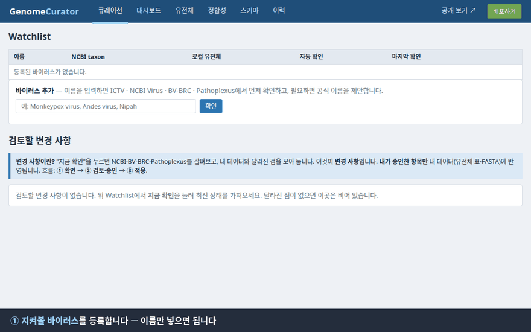
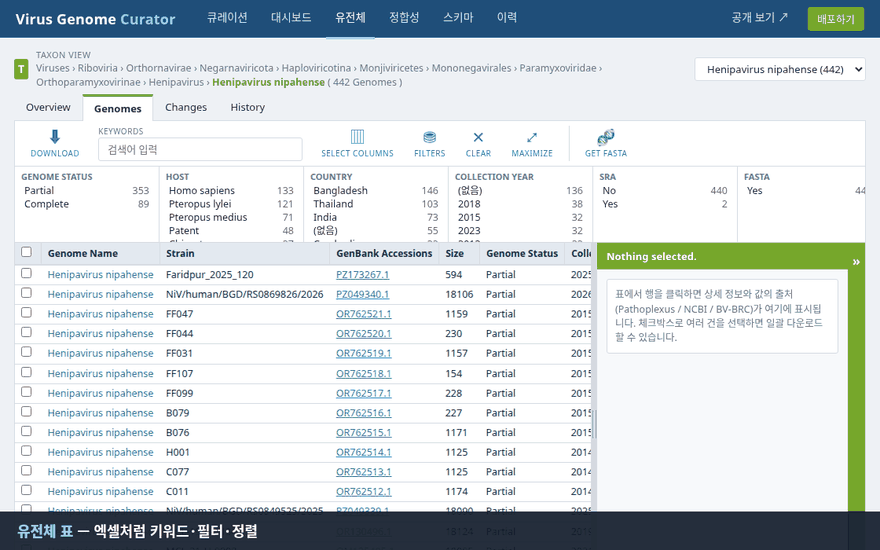
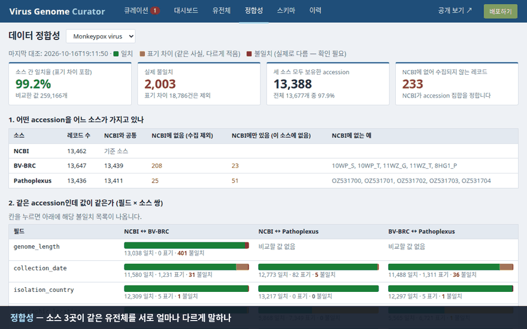
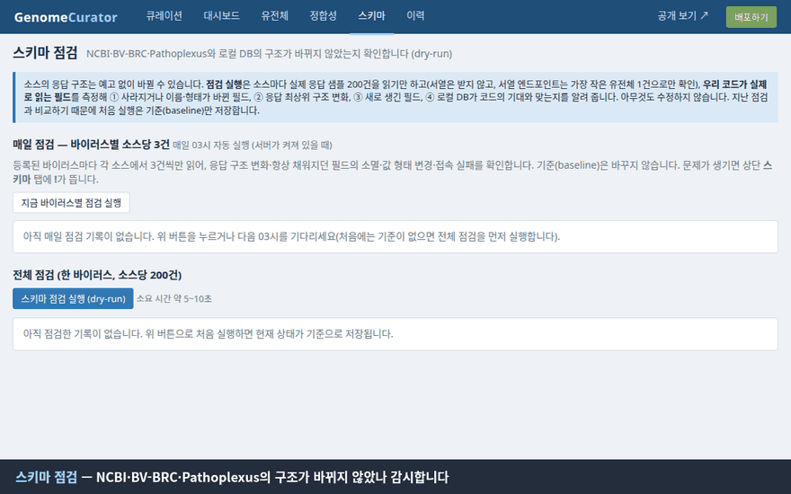
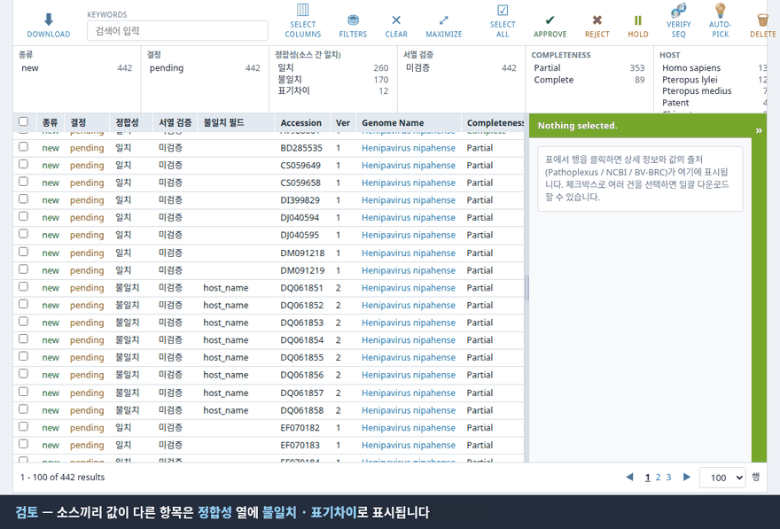

# Virus Genome Metadata Curator — 상세 가이드 (한국어)

> 처음이라면 [README](../README.ko.md)부터 보세요. 이 문서는 화면별 설명, 정합성·스키마 점검의 원리, FAQ, 로그 읽는 법, 코드 지도 등 **자세한 내용**을 담고 있습니다.

## 한 줄 요약 (Synopsis)

```bash
mamba env create -f environment.yml && mamba activate genomecurator

python -m genomecurator watch-add "Henipavirus nipahense"   # 이 바이러스를 지켜보세요
python -m genomecurator serve --open                         # 그리고 웹에서 승인하세요
```

그게 전부입니다. 나머지는 이 문서가 아니라 웹 화면이 알려 줍니다.

<div align="center">



<sub>▶ 빈 화면에서 Henipavirus nipahense를 등록 → 소스 3곳 확인 → 442건 승인 → 반영까지 (실제 NCBI·BV-BRC·Pathoplexus에 접속한 화면, 약 2분을 30초로 줄였습니다)</sub>

</div>

## 왜 만들었나 (그리고 왜 이렇게 깐깐한가)

유전체 메타데이터를 NCBI에서 받고, BV-BRC에서 받고, Pathoplexus에서도 받다 보면 이런 일이 생깁니다.

* 같은 accession인데 **길이가 197,179 bp**라는 곳과 **197,157 bp**라는 곳이 있다.
* 수집일이 `2022-07`이라는 곳, `2022-07-11`이라는 곳, 그리고 **`1922-05-30`** 이라는 (아마도 오타인) 곳이 있다.
* 어제 있던 필드가 오늘 사라졌는데, 아무도 알려 주지 않는다.
* 스크립트가 조용히 실패하고, 빈 칸으로 덮어쓴 걸 석 달 뒤에 발견한다.

이 도구는 이 사고들을 **한 번도 겪지 않기 위해** 만들어졌습니다. 그래서 의심이 많습니다.

| 철칙 | 뜻 |
|---|---|
| **승인 전에는 아무것도 안 바뀐다** | 새 소식은 전부 *changeset*(변경 사항 묶음)으로만 쌓입니다. 승인하고 `Apply`를 눌러야 내 데이터가 됩니다. |
| **거절한 건 다시 안 온다** | 같은 내용이면 다음 확인 때 또 올라오지 않습니다. |
| **소스가 하나라도 아프면 멈춘다** | 일부 소스만으로 병합하면 값이 비워질 수 있어서, 조용히 넘어가지 않고 확인 자체를 중단합니다. |
| **말이 다르면 서열로 물어본다** | 메타데이터가 애매하면 서열 본문(헤더 뺀)이 같은지로 *같은 레코드인지* 확인합니다. |
| **소스도 바뀐다** | NCBI·BV-BRC·Pathoplexus의 응답 구조가 바뀌었는지 매일 감시합니다. |

## 소스 삼형제

```
                ┌────────────┐
   NCBI Virus ──┤  어느 accession이 있는지 "정함" (기준)
                └─────┬──────┘
                      │  같은 accession끼리 묶어서
   Pathoplexus ───────┤  메타데이터를 채움 (1순위)
   BV-BRC ────────────┘  그다음 NCBI, 마지막 BV-BRC
                      ▼
            필드마다 "누구 값을 썼는지" 기록 (field_provenance)
```

* **NCBI Virus**가 accession 집합을 정합니다. 나머지는 그 목록에 *보강*할 뿐, 목록을 늘리지 않습니다.
* 값이 겹치면 **Pathoplexus > NCBI Virus > BV-BRC** 순으로 채택합니다.
* 내부 표는 BV-BRC 스타일 컬럼(`genome`, `genome_sequence`)입니다.

## 설치 (Installation)

### 추천: conda / mamba

```bash
git clone https://github.com/CHOICHI-HWAN/GenomeCurator.git
cd GenomeCurator
mamba env create -f environment.yml      # conda 쓰시면 mamba 대신 conda
mamba activate genomecurator
python -m pytest -q                      # 선택: 전부 초록불이면 정상
```

### 한 번에 시작 (환경 생성 → 실행 → 브라우저 열기)

| OS | 실행 |
|---|---|
| Linux | `./scripts/start.sh` |
| macOS | Finder에서 `scripts/start.command` 더블클릭 (처음 한 번 `chmod +x scripts/start.*`) |
| Windows | `scripts\start.bat` 더블클릭 |

스크립트는 `mamba`/`conda`가 있으면 `genomecurator` 환경을 (없으면 만들어서) 쓰고, 둘 다 없으면 `.venv`로 대신합니다.
포트를 바꾸려면 `./scripts/start.sh --port 8001`.

### Docker (x86 · ARM 공용 이미지)

```bash
docker build -t genomecurator .
docker run -d -p 127.0.0.1:8001:8001 -v genomecurator-data:/data genomecurator    # http://127.0.0.1:8001
```

이미지는 `environment.yml` 그대로 conda 환경을 만들며 `linux/amd64`, `linux/arm64`에서 돌아갑니다. 데이터는 `/data` 볼륨에 남습니다.
로그인 기능이 없으므로 위처럼 **127.0.0.1로만** 공개하세요.

### conda 없이

```bash
python -m venv .venv && source .venv/bin/activate     # Windows: .venv\Scripts\activate
pip install -e ".[dev]"
```

ARM(Apple Silicon, Raspberry Pi·Graviton 등)도 conda-forge에 모든 의존성이 있어 같은 방법으로 설치됩니다.

Python 3.10 이상, 인터넷(NCBI·BV-BRC·Pathoplexus 접속)이 필요합니다. "공개 페이지 배포"를 쓰려면 git과 `origin` push 권한도 필요합니다.

## 빠른 시작 (Quick start)

```bash
# 1) 지켜볼 바이러스 등록 (이름을 NCBI에서 확인하고, 바이러스가 아니면 정중히 거절합니다)
python -m genomecurator watch-add "Henipavirus nipahense"

# 2) 웹 열기  →  http://127.0.0.1:8000
python -m genomecurator serve --open

# 3) 큐레이션 화면에서 [지금 확인] → [검토하기] → 항목 선택 → Approve → Apply
```

도중에 길을 잃으면 각 화면 상단의 파란 안내 상자를 읽어 보세요. 사람 말로 적어 두었습니다.

> 포트 8000이 이미 쓰이고 있다면(`Address already in use`) `--port 8001`처럼 바꾸세요.

## 화면 구경 (The tour)

| 탭 | 하는 일 |
|---|---|
| **큐레이션** | 바이러스 목록(추가·편집·삭제) + *검토할 변경 사항* 카드. "새로 발견 / 정보 바뀜 / 사라짐" 숫자, 승인·거절·보류 진행 막대, 다음 할 일을 한 문장으로 알려 줍니다. |
| **대시보드** | 월별 등록, 수집 연도, 국가, 숙주 같은 차트. |
| **유전체** | 엑셀처럼 필터·정렬·열 선택·TSV 내보내기. 오른쪽 상세 패널은 **끌어서 너비를 조절**할 수 있고, Pathoplexus 변이 정보도 불러옵니다. |
| **정합성** | 세 소스가 서로 얼마나 일치하는지 한눈에. 일치(초록) / 표기만 다름(노랑) / 진짜 다름(빨강). 서열로 검증하는 버튼도 여기. |
| **스키마** | 소스와 내 DB의 *구조*가 코드의 기대와 맞는지 점검. **간단히 보기**(내 열 × 소스 3곳 표, 확인이 필요한 열이 맨 위에 모임)와 **자세히 보기**(소스 필드가 내 `genome` 열에 이어지는 선까지 보이는 구조도)를 탭으로 오가며, 이상이 있는 필드·열을 색으로 강조합니다. 문제가 있으면 탭에 `!` 배지가 뜹니다. |
| **QC** | 서열 통계·Nextclade(clade/lineage, 품질) 결과, 데이터셋 버전과 업데이트 버튼, *QC 실행 + 확인*. |
| **분석** | Apache Superset 켜기/끄기/열기(설치 여부도 안내). 별도 프로그램이라 처음 한 번만 `superset.sh init`이 필요합니다. |
| **작업** | 서버에서 도는 모든 작업(추가·조회·확인·적용·다운로드·검증·점검·배포·자동 실행)의 상태·진행률·로그·오류. 다른 메뉴로 가도 계속되고 여기서 다시 봅니다. |
| **이력** | 누가 언제 무엇을 했는지 + 서버 로그(경고만 / 오류만 필터). |
| **공개 보기 / 배포하기** | 읽기 전용 정적 페이지를 GitHub Pages로 게시. |

오래 걸리는 작업은 화면 가운데에 진행 모달(큰 진행 막대 + 로그)이 뜨고, 새로고침해도 이어집니다.

<div align="center">



<sub>▶ 유전체 표 — 키워드·필터·상세 패널(값마다 <i>어느 소스에서 왔는지</i> 표시)·끌어서 너비 조절</sub>

</div>

## 승인 흐름 (changeset)

```
 [지금 확인] ──► 소스 3곳 조회 ──► 내 데이터와 비교 ──► changeset 생성 (아직 아무것도 안 바뀜)
                                                         │
                          ┌──────────────────────────────┘
                          ▼
              검토: Approve / Reject / Hold  (정합성 열로 "소스끼리 다른 항목"만 골라 볼 수 있음)
                          │
                          ▼
            적용 전 점검(Dry-run): 디스크 · 링크 · 샘플 서열 확인
                          │
                          ▼
                [Apply]  ──►  표와 FASTA에 반영 (중간에 예외가 나면 파일·DB 모두 되돌림)
```

판정 규칙: 메타데이터 값이 바뀌거나 GenBank `.version`이 올라가면 **changed**, 처음 보면 **new**, NCBI에서 사라지면 **removed**.

## 정합성 — 이 도구의 집착

### 1. 소스끼리 맞는지 (reconcile)

`check`할 때마다 같은 accession을 세 소스에서 필드별로 비교합니다. 결과는 세 부류입니다.

* **일치**: 그냥 같음.
* **표기 차이**: 같은 사실을 다르게 적음 (`USA: CA` vs `USA, CA`, `2022-07` vs `2022-07-11`, `Zaire` vs `Democratic Republic of the Congo`). 불일치로 세지 않습니다.
* **불일치**: 진짜 다름. 사람이 봐야 합니다.

mpox 1만 3천 건에서는 소스 간 일치율 99%대였고, 남은 불일치 중에는 오타(`1922-05-30`)와 국가 충돌(콩고민주공화국 ↔ 대한민국)이 있었습니다. 이런 걸 잡으려고 만들었습니다.

<div align="center">



<sub>▶ mpox 1만 3천 건으로 본 정합성 탭 — 필드별 일치 막대 → 실제로 다른 값 → 서열 검증 계획(dry-run)</sub>

</div>

### 2. 서열로 확인 (seqcheck)

메타데이터로 판단이 안 되면 서열 본문을 비교합니다 (헤더·공백 제거, 대문자, SHA-256). 기준은 NCBI.
몇백 MB를 막 받지 않도록 **먼저 dry-run**을 합니다: 링크와 길이만 조회해서 "길이가 다르면 받을 것도 없이 다름 확정", "같으면 받아서 비교"로 나눕니다. mpox 404건에서 약 314MB를 아꼈습니다.
받은 서열은 저장하지 않고 결과만 남깁니다.

### 3. 소스의 구조 변화 (schema-check)

소스의 응답 구조는 예고 없이 바뀝니다. **우리 코드가 실제로 읽는 필드를 측정**해서 사라지거나(이름이 바뀐 후보도 알려 줌) 형태가 바뀌거나 응답 구조가 달라지면 "소스 코드 업데이트 필요"라고 말해 줍니다.
매일 새벽 3시에 바이러스마다 소스당 3건씩 가볍게 점검하고, 바뀐 게 있으면 **스키마** 탭에 `!`가 켜집니다.

결과는 두 가지 모양으로 볼 수 있습니다. **간단히 보기**(기본)는 내 `genome` 열마다 NCBI·BV-BRC·Pathoplexus 중 어느 소스의 어떤 필드가 채우는지를 한 표에 색 알약으로 보여 주고, 확인이 필요한 열을 맨 위에 모아 줍니다. **자세히 보기**는 **테이블 구조도**입니다. 왼쪽에 소스 3곳의 필드(NCBI는 중첩 객체 그대로), 오른쪽에 내 `genome` 테이블의 열을 놓고 *코드가 실제로 읽어서 채우는 연결*을 선으로 잇습니다. 연결은 손으로 적은 표가 아니라 어댑터에 값을 넣어 보며 **측정**한 것이라 코드가 바뀌어도 어긋나지 않습니다.
사라진 필드는 <b>빨강</b>, 그 필드가 채우던 열은 <b>주황</b>(다른 소스가 대신 채울 수 있으면 오류가 아니라 경고), 새로 생긴 필드는 <b>파랑</b>으로 표시되고, 열을 누르면 어느 소스의 어느 필드가 우선순위 순으로 채우는지 나옵니다.

<div align="center">



<sub>▶ 스키마 점검의 간단히 보기와 테이블 구조도 — 처음은 실제 결과(이상 없음), 뒤쪽은 <b>시연을 위해 "소스가 필드를 지우고 이름과 응답 구조를 바꿨다"고 가정</b>한 화면입니다 (실제로 바뀐 것이 아닙니다)</sub>

</div>

### 4. 다른 값 중에서 고르기 (resolve)

소스끼리 값이 다르면 **검토 화면에서 항목을 눌러** 무엇이 다른지 보고 직접 고릅니다.

* 오른쪽 패널에 다른 필드마다 **소스별 값**이 나란히 나오고, 표기 차이인지 진짜 불일치인지 표시됩니다.
* **★ 추천**이 미리 골라져 있고 **이유와 신뢰도**가 붙습니다. 규칙은 이렇습니다: 불가능한 날짜는 뺀다 → 길이·버전은 NCBI(서열을 NCBI에서 받아 검증하므로) → 같은 사실의 다른 표기는 가장 잘 쓴 쪽(가장 구체적인 날짜, 학명, 표준 국가명) = **높음** → 소스 다수가 같은 값 = **보통** → 모두 다르면 우선순위로 제안하되 **낮음**(직접 확인).
* 값을 고르거나 직접 입력해서 저장하면 그 항목에 **바로 반영**되고, **다음 `check`에서도 유지**됩니다(소스가 바뀌어도 내가 정한 값을 존중). 언제든 기본값으로 되돌릴 수 있습니다.
* 표에서 행을 **끌어서**(드래그) 또는 **Shift+클릭**·체크박스로 여러 건을 고르고 **선택 항목에 추천 적용**을 누르면, 고른 항목만 추천값으로 한 번에 선택합니다("보통 이상" 또는 "낮음까지 모두"를 고르는 창이 뜹니다).
* 툴바의 **Auto-pick (전체)**는 신뢰도 "보통" 이상인 추천을 한 번에 선택하고, **"낮음"은 사람이 보도록 남겨 둡니다.** 어차피 소스가 둘뿐인 바이러스는 대부분 "낮음"이니, 근거 없는 일괄 적용을 막는 장치입니다.

<div align="center">



<sub>▶ 검토 화면: 항목을 누르면 소스별 값과 추천(이유·신뢰도) → 고르기 → "선택 완료" → Auto-pick</sub>

</div>

### 5. 내 데이터가 멀쩡한지 (verify)

FASTA 실제 길이·md5가 기록과 맞는지, 날짜가 미래가 아닌지, 고아 행이 없는지 등을 봅니다. 문제가 있으면 종료 코드 1.

### 6. 서열 QC (서열 통계 · Nextclade)

저장된 서열을 한 번 더 검사합니다 (**QC** 탭). 경고만 하며 아무것도 막지 않고, 큐레이션 값을 몰래 바꾸지 않습니다. 결과는 `qc_result` 테이블에 쌓이는 *파생 데이터*라서 지우고 다시 계산해도 됩니다.

* **서열 통계**(모든 바이러스): 길이, N 비율(1% 이상 주의 · 5% 이상 불량), 모호 염기(0.1% 이상 주의), GC, **기록된 길이와 서열 길이가 같은지**(다르면 불량).
* **Nextclade**(데이터셋이 있는 바이러스만): clade, lineage와 자체 품질 점수(결측·혼합 부위·프레임시프트·정지코돈 등 → 양호/주의/불량). 데이터셋이 없는 바이러스(예: Nipah)는 서열 통계만 합니다.
* **데이터셋**: 필요할 때 Nextstrain에서 내려받아 `data/nextclade/`에 둡니다(저장소에는 넣지 않습니다). 바이러스마다 로컬 버전과 새 버전 유무가 보이고, 오래됐으면 **데이터셋 업데이트** 버튼이 나옵니다. 어떤 바이러스에 어떤 데이터셋을 쓰는지는 `qc.py`의 `DATASETS`(종명 → 데이터셋)이고, `GC_NEXTCLADE_DATASETS="종명=데이터셋경로;…"`로 추가할 수 있습니다.
* **큐레이션과의 연결**: Nextclade가 부른 clade/lineage는 NCBI·BV-BRC·Pathoplexus와 나란히 **네 번째 소스**로 참여합니다. 소스와 같으면 아무 일도 없고, 소스가 비어 있으면 채우는 후보, **다르면** 검토 화면의 "소스 간 불일치"에 Nextclade 값이 함께 올라옵니다(다른 데이터베이스가 같은 값이면 추천 신뢰도 *높음*, 아니면 *보통*). 고르는 건 사람이고, 선택은 이후 확인에서도 유지됩니다. **QC 실행 + 확인** 버튼이 QC와 지금 확인을 한 작업으로 합니다.
* 같은 서열(md5)과 같은 도구·데이터셋 버전이면 다시 계산하지 않습니다. 유전체 화면에는 QC · Nextclade Clade/Lineage 열과 QC 필터가 있습니다.
* CheckM2는 세균·고세균용이라 쓰지 않습니다. 바이러스 완성도는 Near complete 등급(참조 게놈 대비 길이)으로 봅니다.

### 7. 다른 프로그램에 넘기기 (export)

큐레이션한 유전체를 **내보내기** 탭(또는 `python -m genomecurator export`, 내부 API)으로 넘깁니다. 같은 id·같은 순서의 `metadata.tsv`와 `sequences.fasta`, 그리고 `manifest.json`(건수·경고·SHA-256·Nextclade 데이터셋 버전)과 `nextstrain-config.yaml`이 한 폴더(기본 `data/exports/<바이러스>/<시각>/`)에 만들어집니다.

* **형식 `nextstrain`**: [nextstrain/mpox](https://github.com/nextstrain/mpox)의 `phylogenetic/` 워크플로가 읽는 열에 맞춥니다. id는 **`PPX_accession`**(FASTA 헤더와 같음; 워크플로가 포함·제외 목록을 PPX accession으로 바꿔 `augur filter --exclude`와 맞추므로 INSDC id를 쓰면 제외가 조용히 무시됩니다. Pathoplexus accession이 없는 유전체는 빠지고 미리보기가 건수를 알려 줍니다), 날짜는 `YYYY-MM-DD`에 모르는 부분은 `XX`(`2023-XX-XX`), `region`(대륙)·`country`·`division`·`location`은 국가·`geographic_location`에서 만들고, `clade/lineage/outbreak`는 큐레이션 값이 우선이며 없으면 Nextclade 값, `coverage`·`QC_rare_mutations` 등 Nextclade QC 열은 QC 탭의 결과입니다. **QC를 먼저 실행하세요**: 워크플로의 기본 필터가 `QC_rare_mutations`를 보기 때문에 값이 없는 행은 걸러집니다(미리보기에서 경고로 알려 줍니다).
* **형식 `plain`**: `genome` 표의 모든 열과 QC 열을 이름 그대로 줍니다.
* **필터**: 최소 길이, 완성도(Complete/Near complete/Partial), QC 불량·오류 제외, clade, 서열이 있는 것만(기본).
* **공개(Open) 데이터만** 나갑니다. 수집 대상이 NCBI(INSDC) accession으로 정해지므로 Pathoplexus 제한 사용 데이터는 들어 있지 않고, `dataUseTerms`는 `OPEN`으로 적힙니다.
* **내부 API**: `GET /api/export/{바이러스id}/metadata.tsv`, `.../sequences.fasta`, `.../preview`, `POST .../build`(서버 작업), `GET /api/exports`. 다른 프로그램에서는 `curl`로 바로 받을 수 있습니다.
* **쓰는 법(mpox)**: QC 탭에서 QC 실행 → `git clone https://github.com/nextstrain/mpox` → 체크아웃 안으로 바로 내보내기:
  ```bash
  python -m genomecurator export "Orthopoxvirus monkeypox" --nextstrain-dir ~/mpox/phylogenetic
  cd ~/mpox/phylogenetic
  nextstrain build . --configfile defaults/mpxv/config.yaml build-configs/genomecurator/config.yaml   # 전체 clade
  ```
  * **config를 두 개** 줘야 합니다. 워크플로의 `Snakefile`은 `defaults/*/config.yaml`을 *config가 비어 있을 때만* 읽으므로, 우리 overlay만 주면 `build_name`이 없다는 `KeyError`가 납니다(확인함). overlay는 `inputs`(로컬 파일)와 `use_remote_files: false`만 덮어씁니다. 다른 빌드는 `defaults/hmpxv1/config.yaml`(clade IIb), `defaults/clade-i/config.yaml`.
  * 기본 입력이 매번 웹(`data.nextstrain.org`)에서 받는 URL이라 로컬 데이터를 쓰려면 이 `inputs` 교체가 필요하고, 워크플로 코드(`path_or_url`)는 로컬 경로를 그대로 쓰므로 **규칙을 고칠 필요는 없습니다**.
  * 파일은 체크아웃의 `data/genomecurator/`에, 설정은 `build-configs/genomecurator/config.yaml`에 상대 경로로 써집니다. `--nextstrain-dir` 없이 `--out`을 쓰면 절대 경로라 Docker 런타임(`nextstrain build --docker`)에서는 파일이 보이지 않으니 `--ambient`/`--conda`로 돌리세요.
* 확인한 것: 위 내보내기로 만든 파일에 Nextstrain mpox 저장소의 `scripts/map_accessions.py`(실제 `exclude.txt`), `augur filter`(기본 쿼리), Snakemake의 `decompress`·`map_accessions`·`filter` 규칙을 실제로 돌렸고, 전체 DAG(19단계)가 원격 입력 없이 풀리는 것까지 봤습니다. 정렬·트리 구축(`align`~`export`)은 서열이 충분해야 의미가 있어 돌려 보지 않았습니다. 워크플로 설정이 바뀌면 열이 달라질 수 있습니다.

### 8. 비공개 유전체와 최종 분석용 데이터세트 (private)

목표: 공개 데이터(위의 큐레이션 세트)와 **로컬 비공개 유전체**를 합친 분석용 데이터세트를 만들어 Nextstrain에서 돌리는 것입니다. 데이터세트를 준비하고, 필요하면 *Nextstrain 탭*(아래 11번)에서 워크플로까지 돌립니다.

* **분리 보관**: 비공개 유전체는 `genome` 표가 아니라 별도 저장소(`private_genome` 표 + `data/private/<바이러스>/`)에 둡니다. 큐레이션 세트는 NCBI accession으로 정해지므로 `genome`에 넣으면 다음 *지금 확인*에서 "NCBI에서 사라짐"이 되고, 공개 페이지·Superset·TSV 다운로드·백업에도 섞이기 때문입니다. 분리해 두면 그 어느 것에도 나타나지 않습니다.
* **올리는 두 가지 방법** (**비공개** 탭):
  1. **스프레드시트로 입력**: 페이지 안에 엑셀처럼 이어진 **진짜 스프레드시트**([Jspreadsheet CE](https://github.com/jspreadsheet/ce), MIT)가 있습니다. 한 줄이 유전체 하나이고 한 건만 올리려면 한 줄만 씁니다. 칸에 바로 쓰고, 끌어서 범위를 선택하고, **엑셀·구글 시트에서 복사해 Ctrl+V**, 모서리를 끌어 채우고, 오른쪽 클릭으로 줄·열을 삽입/삭제합니다(`+ 열 추가`로 Nextstrain에 그대로 전달할 열을 더합니다). **파일을 시트로 불러오기**로 기존 `.xlsx`/`.tsv`/`.csv`를 열어 고칠 수도 있습니다. **줄마다 서열 칸**이 있습니다: 시트 마지막 열 *서열*을 **더블클릭**하면 그 줄의 서열을 붙여넣거나 FASTA 파일을 고를 수 있고(FASTA 파일을 그 칸에 **끌어다 놓아도** 됩니다), 칸에는 `✔ 길이 bp`가 표시됩니다. 여러 건은 시트 아래 **여러 서열 한꺼번에 (FASTA)**에서 파일(여러 개 가능)이나 붙여넣기로 연결하며 헤더가 시트의 id와 같은 줄에 붙고, 시트에 없는 id는 새 줄이 됩니다. 서열은 id에 묶여 있으니 id 칸을 고치면 연결이 끊긴 것으로 표시됩니다. *검사*가 문제 있는 줄을 색으로 표시하고(빨강 = 오류, 노랑 = 경고), 입력 중인 시트 내용은 이 브라우저에 임시 저장됩니다(서열은 저장하지 않으니 새로고침하면 다시 연결). 시트 라이브러리는 CDN에서 불러오므로 이 탭에는 인터넷이 필요합니다.
  2. **스프레드시트 파일(.xlsx)로 올리기**: 탭에서 **`.xlsx` 템플릿**을 받아 `genomes` 시트에 한 줄에 하나씩 채웁니다(필수 열은 노란색, `열 설명` 시트에 열별 설명, mpox는 clade 드롭다운). `.tsv`/`.csv`도 됩니다. FASTA는 따로 올리며 헤더는 id와 같아야 합니다. 시트에 다른 열을 더 넣어도 보존됩니다.
  * **이 업로드의 기본 clade**: clade 칸이 빈 행에 채울 값(mpox는 *Ib*가 미리 선택되어 있음). 직접 쓴 clade는 덮어쓰지 않고, Nextclade가 다르게 판정하면 ⚠로 표시합니다.
* **올릴 때마다 버전**: 같은 id를 바뀐 내용으로 올리면 v2, v3…으로 기록됩니다(바뀐 열, 서열이 바뀌었는지, 원본 파일, 메모). 같은 내용이면 변경 없음이고 새 버전이 생기지 않습니다. 이전 버전(서열 포함)은 삭제한 뒤에도 남아 있고, *이 버전으로 복원*은 그 내용을 **새 버전**으로 만듭니다(이력은 고쳐 쓰지 않습니다). 서열은 `data/private/<바이러스>/`(현재)와 `_versions/`(버전별)에 있습니다. 내보내기 manifest에는 내보낸 버전이 기록됩니다.
* **커버리지 하한**: 비공개 업로드도 `GC_MIN_COVERAGE_PCT`(기본 80)를 따라, 기준 게놈 대비 짧은 서열은 검사에서 오류로 막힙니다.
* **가져오기**(**비공개** 탭 또는 CLI): Nextstrain에 준하는 메타데이터 TSV(id 열 `PPX_accession` 또는 `accession`, 그리고 `strain`, `date`, `country`, `division`, `location`, `host`, `clade` …)와 헤더가 그 id인 FASTA. 먼저 **검사(dry-run)**: 구조 오류(id 누락·중복·공개 accession과 충돌·서열 없는 행·행 없는 서열·서열 문자 오류)는 가져오기를 막고, 날짜(`2024-03` → `2024-03-XX`)·대륙(국가에서)·길이(서열에서)는 맞추고 경고로 알립니다. 같은 id를 다시 가져오면 갱신합니다.
  ```bash
  python -m genomecurator private-check  "Orthopoxvirus monkeypox" --metadata my.tsv --fasta my.fa
  python -m genomecurator private-import "Orthopoxvirus monkeypox" --metadata my.tsv --fasta my.fa
  python -m genomecurator qc "Orthopoxvirus monkeypox" --private        # 서열 통계 + Nextclade
  ```
* **QC**: 공개 유전체와 같은 서열 통계·Nextclade. Nextclade가 부른 clade/lineage/outbreak와 QC 열이 비어 있는 칸을 채우고, 직접 입력한 clade가 Nextclade와 다르면 비공개 탭에 ⚠로 표시합니다(덮어쓰지 않음).
* **내보내기**: `export --with-private`(탭의 *비공개 포함*). 공개 파일(`metadata.tsv`, `sequences.fasta`)에는 **비공개가 섞이지 않고**, 비공개는 **별도 파일**(`metadata-private.tsv`, `sequences-private.fasta`)로 나가 설정 overlay의 `private_metadata` / `private_sequences`에 연결됩니다. 워크플로가 이를 공개 데이터 필터 *뒤에* 붙이므로 비공개 행은 날짜·QC 필터를 받지 않습니다(`source_private` 열로 구분되어 Auspice에서 색을 입힐 수 있습니다). manifest에 `contains_private`, 폴더에 `.gitignore`(`*private*`)와 `PRIVATE_DATA.txt`가 생깁니다. 이 폴더는 공유하지 마세요.
* **`accession` 열**: 워크플로의 병합 스크립트(`combine_data_sources.py`)가 아직 `accession` 열로 행을 맞춰서, 현재의 PPX 기반 메타데이터에서는 이 열이 없으면 `metadata file missing 'accession'`으로 실패합니다(확인함). 내보내기는 공개·비공개 파일 모두에 id와 같은 `accession` 열을 넣어 이를 피합니다. 수정 없는 스크립트로 공개 7 + 비공개 3행이 병합되는 것까지 확인했습니다.
* **백업**: 일반 백업(`backup`)에는 비공개가 **들어가지 않습니다**(백업 파일을 공유할 수 있도록). 비공개까지 지키려면 `backup --with-private`를 쓰고, 그 파일은 비공개 데이터와 똑같이 다루세요.

### 9. 데이터셋에서 제외 (삭제하지 않고 보관)

최종 분석용 데이터셋에서 빼고 싶은 유전체(조립이 이상한 것, 오염 의심, 분석 대상이 아닌 것…)는 **삭제하지 말고 제외 표시**를 합니다.

* **유전체 탭**에서 유전체를 고르고(체크박스, 행 끌기, Shift+클릭, 필터 후 Select all) 툴바의 **데이터셋에서 제외**를 누릅니다. 사유는 선택이며 `excluded.tsv`에 기록됩니다. **제외 해제**로 되돌립니다. *데이터셋* 열(포함/제외)과 필터로 상태를 봅니다. 비공개 유전체는 **비공개 탭**의 줄마다 제외/풀기 버튼이 있습니다.
* 표시일 뿐이라 유전체·서열·이력·QC는 **그대로 보관**됩니다. *지금 확인*·적용·QC도 평소처럼 동작하고, 제외 표시는 새 changeset이 와도 유지됩니다.
* **내보내기**는 제외된 유전체를 건너뜁니다. 미리보기에 건수가 경고로 나오고, 내보낸 폴더에 `excluded.tsv`(accession, strain, 사유, 시각; 비공개 포함 내보내기에는 `excluded-private.tsv`도)와 manifest의 `excluded` 항목이 남아 어떤 데이터셋에서 무엇이 왜 빠졌는지 추적할 수 있습니다.
* `Removed`와 다릅니다: `Removed`는 NCBI에서 사라졌거나 커버리지 하한 미만이라 *큐레이션 세트에서 빠진* 것이고, 제외는 *특정 데이터셋에서만 빼는* 결정입니다.
* CLI: `python -m genomecurator exclude "Orthopoxvirus monkeypox" ACC1 ACC2 --reason "오염 의심"` (`--undo`로 해제, `--private`로 비공개 id, `--list`로 목록). API: `GET/POST /api/exclusions/{바이러스id}`.

### 10. 데이터셋 (분석할 유전체를 골라 저장하기)

분석마다 대상이 다릅니다(예: clade Ib만, 2024년 이후만, 완전한 게놈만). **데이터셋** 탭에서 대상을 *정의*해 이름으로 저장하고 필요할 때마다 내보냅니다.

* **정의일 뿐입니다**: 유전체·서열을 복사하거나 지우지 않습니다. 구성: **규칙**(모두 만족해야 하며 비우면 제한 없음) — clade, lineage, outbreak, 대륙, 국가, 숙주, 완성도, 수집 연도 범위, 길이 범위, 뺄 QC 상태, 서열이 있는 것만; **직접 넣기**(규칙과 상관없이 포함, accession 한 줄에 하나)와 **직접 빼기**(이 데이터셋에서만 제외); **비공개 포함**(별도 파일로).
* **규칙 고르기**: 탭이 데이터에 실제로 있는 값을 건수·서열 있는 수와 함께 보여 줍니다(많으면 찾기). 클릭할 때마다 **멤버 수**, clade·국가·연도 분포, 경고(서열이 없어 빠지는 수 등)가 바로 나옵니다. 처음이면 **프리셋**(mpox: clade Ib / Ia / I(Ia+Ib) / IIb / 완전한 게놈)으로 시작하세요.
* **판단 기준**: 규칙은 내보내기가 쓰는 *그 행*(큐레이션된 clade, 없으면 Nextclade 값 등)으로 판정하므로 "미리보기가 센 것"과 "내보낸 것"이 같습니다. 전역 **데이터셋에서 제외** 표시는 모든 데이터셋에서 빠지고, *직접 빼기*가 *직접 넣기*와 규칙보다 우선합니다.
* **내보내기**: `exports/<바이러스>/<데이터셋 이름>/<시각>/`에 `metadata.tsv`, `sequences.fasta`, `manifest.json`, 설정(비공개 포함이면 별도 파일도)을 씁니다. manifest의 `dataset`에 이름·규칙·**멤버 id 해시**가 기록되고 데이터셋의 *내보낸 기록*에도 남으므로, 규칙이나 데이터가 나중에 바뀌어도 어떤 멤버로 만든 결과인지 추적할 수 있습니다(같은 멤버면 해시가 같습니다). **Nextstrain 빌드**(`mpxv`/`hmpxv1`/`clade-i`)를 정해 두면 설정 파일이 그 빌드의 명령을 안내합니다(Ib는 `clade-i`).
* **정의 삭제**는 정의와 내보낸 기록만 지웁니다. 유전체·서열·이미 내보낸 파일은 그대로입니다.
* CLI: `python -m genomecurator dataset-create "Orthopoxvirus monkeypox" "clade Ib" --clade Ib --build clade-i` / `dataset-list` / `dataset-export ... [--nextstrain-dir ~/mpox/phylogenetic]` / `dataset-delete`. API: `GET/POST /api/datasets`, `POST /api/datasets/{id}/export`, `GET /api/export/{virus}/metadata.tsv?dataset={id}`(+ `sequences.fasta`; 다운로드에는 비공개가 실리지 않음).
* **데이터셋 QC**: 데이터셋 보기 위쪽의 **이 데이터셋 QC 실행**(또는 데이터셋 편집 화면의 *QC 실행*)이 바이러스 전체가 아니라 *그 데이터셋의 멤버만* 서열 통계·Nextclade로 검사합니다(서버 작업, 비공개 포함이면 비공개 멤버도). 바뀌지 않은 서열은 건너뛰고 **다시 계산**은 모두 다시 합니다. 같은 카드에 도구별 양호/주의/불량과 *아직 QC를 안 한 멤버 수*가 나오고, 표의 **QC** 열·필터로 주의/불량만 골라 볼 수 있으며 데이터셋 규칙의 *뺄 QC 상태*로 내보내기에서 뺄 수도 있습니다. 내보내기 전에 QC를 해 두세요(Nextstrain 기본 필터가 `QC_rare_mutations`를 봅니다).
* **유전체처럼 보기**: 데이터셋의 **목록 보기**(또는 `/dataset/<id>`)는 유전체 탭과 같은 표(필터, 정렬, 열 선택, 상세 패널, TSV)를 그 데이터셋의 멤버로만 보여 줍니다. 서열이 없는 멤버도 표시되고(내보내기에서는 빠짐) 위의 배너 **모두 받기**는 이 데이터셋의 서열만 받습니다. 데이터셋이 *비공개 포함*이면 비공개 멤버가 🔒 *출처: 비공개*로 같은 표에 섞여 보이고 *출처* 필터로 나눌 수 있습니다(공개 페이지·일반 유전체 탭에는 여전히 나타나지 않습니다).
* **대시보드에서 보기**: 대시보드 위의 *데이터셋* 선택에서 고르면 모든 차트와 지표가 그 데이터셋의 멤버만으로 그려지고, 차트를 눌러 들어가는 목록도 그 데이터셋 안에서 필터됩니다.
* 서열을 아직 다 받지 않았다면 멤버 수가 서열 있는 것만 셉니다(미리보기가 건수를 알려 줍니다) — 유전체 탭에서 서열을 받은 뒤 다시 보세요.

### 11. Nextstrain 분석 (데이터셋 → 워크플로 → 보관된 결과)

**Nextstrain** 탭에서 데이터셋으로 nextstrain/mpox 워크플로를 돌립니다. 도구가 *내보내기 → 설정(config) 만들기 → 실행 → 결과 보관*을 이어서 합니다.

* **준비물(한 번만)**: ① 도구 환경 — 터미널에서 `mamba env create -f nextstrain/environment.yml`(이름 `gc-nextstrain`; nextstrain-cli, augur, snakemake, nextclade, iqtree, mafft, auspice가 들어 있고 약 1.7 GB, **앱 환경과 별개**입니다). ② 워크플로 저장소 — 탭의 **워크플로 받기**(`git clone https://github.com/nextstrain/mpox` → `data/nextstrain/mpox`; **업데이트** 버튼은 `git pull`이며 분석마다 어느 커밋으로 돌렸는지 기록됩니다). 탭 위쪽이 둘의 상태(✔/✖)를 보여 줍니다.
* **config가 어떻게 만들어지나**: 워크플로의 `Snakefile`은 `defaults/*/config.yaml`을 *설정이 없을 때만* 읽기 때문에, 도구는 **빌드 기본값 → 도구가 만든 overlay** 순서로 두 설정 파일을 넘깁니다(`nextstrain build . --configfile defaults/<빌드>/config.yaml build-configs/genomecurator/config.yaml`). overlay는 ① 웹 주소 입력을 로컬 파일로 바꾸고(`inputs`, `use_remote_files: false`), ② 비공개 포함이면 `private_metadata`/`private_sequences`를 연결하고, ③ 이 분석만의 `build_name`/`auspice_name`(= 실행 이름)을 정하고, ④ **이 데이터셋의 설정**을 덧붙입니다.
* **데이터셋별 설정(YAML)**: 탭의 입력칸에 워크플로 config 중 바꿀 키만 씁니다. 중첩 키는 합쳐집니다 — 예:
  ```yaml
  filter:
    min_length: 150000     # 빌드 기본 170000(clade-i)을 낮춤
  timetree: true           # 시간 기반 트리
  ```
  오른쪽에 **실제로 적용될 설정**(빌드 기본값 + 입력 + 내 설정)이 바로 보이고, `inputs`·`private_*`·`build_name`·`auspice_name`·`strain_id_field`는 도구가 관리하므로 쓰면 거부됩니다. 설정은 데이터셋에 저장됩니다. **빌드**(`mpxv`/`hmpxv1`/`clade-i`)는 데이터셋 정의에서 고릅니다(Ib는 `clade-i`).
* **실행**: *분석 실행*(또는 `python -m genomecurator analyze "Orthopoxvirus monkeypox" "clade Ib"`)은 서버 작업이며 단계별 진행률이 나옵니다. QC가 없어 워크플로의 기본 필터(`QC_rare_mutations`)에서 빠질 멤버가 있으면 **실행 전에 경고**합니다 — 먼저 데이터셋 QC를 하세요. 실행 방식은 `ambient`(Nextstrain 환경의 도구, 기본) 또는 `docker`입니다.
* **분석은 쌓이고 골라 봅니다**: 분석마다 *그때의* 멤버 해시·건수, 규칙, 설정, 워크플로 커밋, 도구 버전, 메모, 로그가 기록되고 결과는 `data/nextstrain/auspice/<실행이름>.json`, 입력 표·manifest·최종 설정은 `data/nextstrain/runs/<바이러스>/<실행이름>/`에 **계속 보관**됩니다. 다시 돌려도 이전 결과를 덮어쓰지 않으며, **멤버·설정·워크플로가 완전히 같으면** 반복하지 않고 기존 분석을 알려 줍니다(*같은 입력이어도 다시 분석*으로 강제). 데이터가 바뀐 뒤(유전체 추가, 제외, 비공개 업로드, 규칙 변경)에 돌리면 **새 분석**이 하나 더 생깁니다.
* **오늘과 비교**: 분석 표는 지난 분석마다 현재 데이터셋과 어떻게 다른지 보여 줍니다 — *멤버 같음* 또는 *데이터가 바뀜(현재 기준 +추가 / −삭제)*, *설정이 다름*, *워크플로 버전이 다름*, 그리고 완전히 같으면 *← 현재와 같은 입력*. 어느 결과가 지금 데이터에 맞는지 한눈에 알 수 있습니다.
* **결과 보기**: 분석 줄의 **Auspice로 보기** — 이 컴퓨터에서 `auspice view`(127.0.0.1만)를 켜서(처음 한 번 확인 창) 보관된 결과 중 그 분석을 엽니다. 데이터가 밖으로 나가지 않습니다. **로그**로 실행 로그 끝부분을, 메모 칸으로 분석에 설명을 남기고, **삭제**는 그 분석의 결과와 기록만 지웁니다(확인 후, 되돌릴 수 없음).
* 라이선스 참고: augur·auspice는 AGPL-3.0, IQ-TREE는 GPL-2.0+라 **별도 환경의 별도 프로그램**으로만 실행하고 저장소·Docker 이미지에 넣지 않습니다. Auspice 서버를 네트워크에 공개하면 AGPL 의무가 생길 수 있으니 `docs/LICENSES.md`를 보세요.
* 한계: 아직 실행 중인 분석을 중간에 취소하는 버튼은 없습니다(서버를 끄면 *중단*으로 기록됨). 큰 데이터셋의 트리 구축은 서열 수에 따라 오래 걸릴 수 있습니다(예: Ib 213건 + 비공개 3건 → 약 1분).

### 12. Squirrel · 변이 프로파일 (같은 데이터셋, 다른 분석)

**Nextstrain 탭**에서 데이터셋을 고르면 Nextstrain 아래에 두 패널이 더 있습니다(공개+비공개 멤버가 함께 들어갑니다). 도구는 별도 conda 환경 `gc-squirrel`에 있습니다: `mamba env create -f squirrel/environment.yml`.

- **Squirrel**: MPXV 정렬·서열 QC·IQ-TREE 계통수·HTML 보고서. clade와 옵션은 데이터셋마다 저장됩니다. 계통수를 만들기 전에 QC만 먼저 돌려 Squirrel이 제안한 서열(N 비율 20% 초과 등)을 빼고(끌 수 있음), IQ-TREE에는 `-st DNA`를 알려 줍니다. 보고서는 *보고서 열기*로 보며 브라우저가 표·스타일 라이브러리를 CDN에서 불러옵니다(데이터는 어디로도 나가지 않음).
- **변이 프로파일**([mutation_profile](https://github.com/insapathogenomics/mutation_profile)): 각 유전체를 참조 서열에 (기본 RefSeq **NC_063383.1**, Nextclade·Squirrel과 같은 기준. **clade I 빌드는 clade I RefSeq 참조 NC_003310.1**을 자동으로 씁니다(처음 한 번 NCBI에서 GenBank 기록을 받아 `data/reference/`에 보관, 서열과 유전자가 같은 기록에서 나옴); 설정에서 고를 수 있고 쓴 참조는 결과에 기록됩니다) minimap2로 정렬해 SNP를 읽고, 앞뒤 염기 맥락과 APOBEC3형(GA>AA, TC>TT) 프로파일을 붙입니다. **각 변이가 어느 유전자에 있는지**는 그 참조의 유전자 주석(워크플로의 `genome_annotation.gff3`)으로 찾아 유전자·산물·코돈 위치·아미노산 변화·동의/비동의/종결/유전자 사이를 함께 기록합니다. 결과: `mutations.tsv`(변이 한 줄씩), `gene_summary.tsv`(유전자별 요약), `summary.json`, 원본 입력 `snps.tsv`. 이웃 서열이 N이거나 삽입·결손인 곳은 SNP로 세지 않습니다.
- 두 분석도 분석 이력에 **보관**되고(멤버 해시·설정·도구 버전·메모·로그), 같은 조건이면 다시 돌리지 않으며(*다시 분석*으로 강제), 오늘의 데이터셋과 비교됩니다. CLI는 없고 화면/API(`POST /api/datasets/{id}/squirrel`, `/mutprofile`)로 실행합니다.

### 13. Pathoplexus 제출 준비 (앱은 업로드하지 않음)

**Pathoplexus 탭**(또는 `python -m genomecurator pathoplexus <바이러스> [--check]`)은 비공개 유전체를 해당 생물의 제출 템플릿과 대조해 줄마다 *통과 / 경고 / 오류*를 보여 줍니다(필수 열, 날짜 형식, 저자 `성, 이름; 성, 이름`, 숙주, 공개 서열과 같은 서열인지, QC). 오류가 없는 행을 골라 **이용 조건**(OPEN 또는 RESTRICTED+만료일)과 그룹 ID를 정하고 *제출 파일 만들기*를 누르면 `data/pathoplexus/<바이러스>/<시각>/`에 `metadata.tsv`, `sequences.fasta`, `submission.json`, `submit.sh`, `README.txt`가 생기고 *zip 받기*로 내려받을 수 있습니다.
- **앱은 올리지 않고 인증 정보를 받지 않습니다.** Pathoplexus 사이트의 *Submit* 화면에서 두 파일을 올려 검토·승인하거나, 본인 터미널에서 `PATHOPLEXUS_TOKEN`을 설정하고 `submit.sh`를 실행하세요.
- **OPEN은 되돌릴 수 없습니다**(승인 즉시 공개, INSDC로 전달). RESTRICTED는 최대 1년이며 기간은 줄이기만 할 수 있습니다.
- 올린 뒤에는 패키지 상태를 *제출함 → 공개됨*으로 직접 바꿔 기록해 두면 비공개 탭에 상태가 표시되고 같은 유전체를 다시 고르지 않게 안내합니다.

## 명령어 모음 (Cheat sheet)

| 명령 | 설명 |
|---|---|
| `watch-add <이름>` | 바이러스 등록 (`--taxon`으로 NCBI 이름·ID 지정) |
| `watch-list` | 등록된 바이러스 |
| `check <이름>` | 소스 3곳 조회 → changeset 생성 (데이터는 안 바뀜) |
| `dry-run <번호>` | changeset의 다운로드 계획 점검 |
| `apply <번호>` | 승인된 항목 적용 (`--approve-all`은 CLI 지름길, 웹 검토를 권장) |
| `reconcile <이름>` | 마지막 check의 소스 간 대조 보고서 |
| `verify [--no-files]` | 로컬 데이터 무결성 검사 |
| `schema-check [--daily]` | 소스·로컬 스키마 점검 (`--daily`는 스케줄러가 쓰는 가벼운 판) |
| `backup [zip]` / `restore <zip>` | 이사할 때: 큐레이션 결과 + FASTA만 담은 이식 가능한 백업 |
| `serve [--port N] [--open] [--no-scheduler]` | 웹 서버 |

```bash
python -m genomecurator --help        # 정확한 옵션은 여기서
```

## 설정 (환경변수)

| 변수 | 기본값 | 뜻 |
|---|---|---|
| `GC_DATA_DIR` | `<저장소>/data` | 데이터 위치 (Windows `set`, macOS/Linux `export`) |
| `NCBI_API_KEY` | (없음) | 있으면 NCBI 요청 한도가 늘어납니다 |
| `GC_CHECK_INTERVAL_HOURS` | `24` | 자동 확인 주기 |
| `GC_REQUEST_DELAY_MS` | `300` | 모든 외부 요청 사이 최소 간격 (예의 바른 손님) |
| `GC_MIN_COVERAGE_PCT` | `80` | 커버리지 하한: 기준 게놈(가장 긴 RefSeq) 대비 이 % 미만이면 큐레이션 대상이 아님(제안 안 함, 이미 있으면 `removed`로 미리 승인; NCBI Complete는 예외; 0이면 끔). 비공개 가져오기에도 적용 |
| `GC_NEAR_COMPLETE_PCT` | `90` | Near complete 기준: NCBI가 Complete가 아니라고 한 유전체 중 길이가 기준 게놈의 이 % 이상이면 "준완전" |
| `GC_DRYRUN_SAMPLE` | `3` | 적용 전 점검에서 샘플로 받아 볼 서열 수 |
| `GC_SCHEMA_CHECK_HOUR` | `3` | 매일 스키마 점검 시각(시) |
| `GC_SCHEMA_CHECK_SAMPLE` | `3` | 매일 점검에서 바이러스·소스당 읽을 레코드 수 |
| `GC_SEQCHECK_MAX` | `2000` | 서열 검증 한 번에 다룰 최대 accession 수 |
| `GC_MIN_FREE_BYTES` | 500 MB | 이보다 디스크 여유가 적으면 적용 전 점검이 막습니다 |
| `GC_LOG_LEVEL` / `GC_LOG_CONSOLE_LEVEL` | `INFO` / `WARNING` | 로그 파일 / 콘솔 수준 |

## 데이터는 어디에 (Output files)

```
data/
├── genomecurator.db          # SQLite: 큐레이션된 표, 출처 기록, 이력, 대조 결과
├── genomes/<바이러스>/*.fna  # 받아 둔 서열 (UTF-8, LF, 모든 OS 동일)
├── snapshots/                # 적용 직전 파일 백업 (실패 시 되돌리는 용도)
├── staging/                  # 적용 중 임시 파일
└── logs/genomecurator.log    # 서버 로그 (5MB씩 5개 회전, job/watch 맥락 포함)
```

`data/`는 용량이 크고 공개하면 안 되는 것이 섞여 있어서 **git에 올라가지 않습니다**. 백업 zip도 마찬가지입니다.

## 로그 읽는 법

한 줄이 이렇게 생겼습니다.

```
2026-10-17 07:14:15,374 INFO  genomecurator.curate [job=add839d0 watch=Henipavirus nipahense] check done in 27.8s
```

시각, 수준, 모듈, `[작업ID 바이러스 changeset]`, 내용. 외부 호출은 URL(키는 가림)·상태·크기·소요 시간이 남고, 실패는 traceback까지 남습니다. 웹의 **이력 → 서버 로그**에서 같은 파일을 볼 수 있습니다.

## Superset으로 다차원 분석

메타데이터를 바이러스·숙주·국가·연도·clade로 이리저리 돌려 보고 싶다면 Apache Superset을 붙이세요. DB는 **읽기 전용**으로 연결되고, 평탄화된 뷰(`v_genome_analysis`)가 준비돼 있습니다.

```bash
mamba env create -f superset/environment.yml
scripts/superset.sh init && scripts/superset.sh run          # http://127.0.0.1:8089 (또는 앱의 '분석' 탭에서 켜기, 또는 python -m genomecurator serve --superset)
scripts/superset.sh bootstrap                                # 연결·데이터셋·차트·대시보드 자동 생성
```

자세한 내용은 [docs/SUPERSET.md](SUPERSET.md).

## 공개용 정적 페이지 (읽기 전용)

`docs/index.html` 한 파일에 개요 차트와 유전체 표(필터·정렬·상세·TSV)가 들어 있습니다. 공개 메타데이터만 담기고 서열·경로·이력·수집 코드는 들어 있지 않습니다.

```bash
python scripts/build_static.py     # 로컬 DB로 docs/index.html 다시 만들기
```

앱의 **배포하기** 버튼은 미리보기로 바이러스·유전체 수를 보여 주고 확인을 받은 뒤, 그 파일만 커밋·push합니다. GitHub Pages는 저장소 Settings → Pages → `main` 브랜치 `/docs`로 지정하세요. 차트는 CDN(Chart.js)을 쓰므로 보는 쪽에 인터넷이 필요합니다.

## 이사 가기 (백업 / 복원)

```bash
python -m genomecurator backup my-backup.zip      # 큐레이션 결과 · 결정 이력 · FASTA (원본 응답과 대기 중 항목은 제외)
python -m genomecurator restore my-backup.zip     # 새 컴퓨터의 data 폴더로 (기존 DB가 있으면 --force)
```

Windows ↔ macOS ↔ Linux 어디서든 풀립니다. 제외된 것은 다음 "지금 확인"에서 다시 만들어집니다.

## 자주 묻는 질문 (FAQ)

**Q. 승인을 안 하고 그냥 두면요?**
아무 일도 안 일어납니다. 그게 설계입니다. 상단 *큐레이션* 탭의 배지가 "검토 안 한 변경 사항이 있어요"라고 조용히 눈치를 줍니다.

**Q. "Pathoplexus: no records (skipped)"가 보여요.**
그 바이러스가 Pathoplexus에 없다는 뜻입니다 (예: Nipah). 정상입니다. 반면 Pathoplexus가 **응답하지 않았다면** 건너뛰지 않고 확인 전체를 중단합니다. 둘은 일부러 다르게 취급합니다.

**Q. 새 Pathoplexus organism은 어떻게 추가하나요?**
따로 설정할 필요가 없습니다. 사이트에서 organism 목록을 읽어 와서, 등록한 바이러스의 NCBI taxon과 맞는 것을 자동으로 연결합니다.

**Q. 불일치가 많은데 다 봐야 하나요?**
아니요. 정합성 탭에서 *표기 차이*는 이미 걸러져 있고, 검토 화면의 **정합성** 열로 "불일치"만 골라 볼 수 있습니다. 항목을 누르면 소스별 값과 **★ 추천**이 나오고, 툴바의 **Auto-pick**이 신뢰도가 높은 추천을 한 번에 골라 줍니다 ("낮음"만 직접 보면 됩니다). 서열 검증 버튼은 길이·버전이 다른 건만 대상으로 삼습니다.

**Q. 스키마 점검이 "코드 업데이트 필요"라고 해요.**
오류 항목의 "조치"에 고칠 함수 이름이 적혀 있습니다 (예: `sources.normalize_ncbi`). 고친 뒤 다시 점검하고 *새 기준으로 저장*하세요. 고치지 않은 채 기준을 갱신해 문제를 덮는 일은 막아 두었습니다.

**Q. 서버를 꺼 두면 매일 점검은요?**
그날은 건너뜁니다. 서버가 켜져 있어야 스케줄러가 돕니다.

## 한계 (솔직하게)

* 서버가 켜져 있어야 자동 확인과 매일 스키마 점검이 돕니다.
* 매일 점검의 NCBI·Pathoplexus 샘플은 "처음 N건"(오래된 레코드)이라 최신 레코드에만 생기는 변화는 늦게 발견될 수 있습니다. 가끔 *스키마* 탭에서 전체 점검을 눌러 주세요.
* 서열이 같다는 것은 "같은 레코드"라는 증명이지, 숙주·날짜 같은 메타데이터가 *옳다*는 증명은 아닙니다.
* 분류 이름(`genome_name`)은 소스 원본 그대로라 `Monkeypox virus`와 `Orthopoxvirus monkeypox`가 섞여 보일 수 있습니다 (수집 범위에는 영향 없음).

## 코드 지도

| 파일 | 역할 |
|---|---|
| `genomecurator/sources.py` | 세 소스 어댑터 (NCBI, BV-BRC, Pathoplexus) + 정규화 |
| `genomecurator/curate.py` | check → changeset → dry-run → apply |
| `genomecurator/reconcile.py` | 소스 간 일치/표기차이/불일치 분류 |
| `genomecurator/seqcheck.py` | 서열 본문 비교(dry-run 계획 + 실행) |
| `genomecurator/schema_check.py` | 소스·로컬 스키마 점검, 매일 점검 |
| `genomecurator/verify.py` | 로컬 데이터 무결성 |
| `genomecurator/web.py` + `templates/` | FastAPI 웹 UI |
| `genomecurator/log.py` | 로깅 (파일 회전 + job/watch 맥락) |
| `genomecurator/db.py`, `config.py` | 스키마·마이그레이션, 설정 |
| `scripts/` | 시작 스크립트, 정적 페이지 생성, Superset 도우미 |
| `CHANGELOG.md` · `CHANGELOG.ko.md` | 버전별 변경 이력 (영문 · 한글) |
| `docs/RELEASING.md` · `docs/DEPENDENCIES.md` | 릴리스 절차, 사용한 라이브러리 |
| `docs/STATUS.md` | 진행 상황과 결정 사항 (다른 곳에서 이어서 작업할 때 먼저 읽을 문서) |

개발할 때는 `python -m pytest -q`. CI는 Windows·macOS·Linux × Python 3.10/3.12, 그리고 `environment.yml`이 실제로 빌드되는지도 매번 확인합니다.

## 이 GIF들은 어떻게 만들었나

위 GIF는 손으로 찍은 게 아니라 **스크립트가 실제 앱을 조종해서** 만듭니다 (`scripts/demo/`). 헤드리스 Chrome을 DevTools 프로토콜로 움직이면서 프레임을 모으고, 커서·자막을 화면 위에 얹어 GIF로 조립합니다. 앱이 바뀌면 GIF도 다시 뽑으면 됩니다.

```bash
pip install -e ".[demo]"                       # Pillow + websocket-client (Google Chrome도 필요)
python scripts/demo/make_gifs.py quickstart    # 빈 폴더에서 시작, 실제 인터넷 접속, 3~4분
python scripts/demo/make_gifs.py explore       # quickstart가 만든 데이터를 보여 줌
```

시연은 임시 복사본에서 돌기 때문에 진짜 `data/`는 건드리지 않습니다. `integrity`와 `schema`는 미리 준비한 시연 데이터가 필요합니다 (`GC_DEMO_ROOT`, 자세한 내용은 `make_gifs.py` 맨 위 설명).

## 버전과 변경 이력

현재 버전은 **0.2.0** 입니다. 버전은 `genomecurator/__init__.py` 한 곳에서만 정하고, 화면 하단·`/api/version`·`--version`에 보입니다.
또한 **DB·changeset·백업**이 "어느 버전이 만들었는지"를 기록하므로, 나중에 이 데이터가 어느 코드에서 나왔는지 추적할 수 있습니다.

```bash
python -m genomecurator --version      # genomecurator 0.2.0 (DB schema 1)
```

* 변경 이력: [CHANGELOG.ko.md](../CHANGELOG.ko.md) (한국어) · [CHANGELOG.md](../CHANGELOG.md) (English)
* 릴리스 방법과 버전 규칙: [docs/RELEASING.md](RELEASING.md)

## 사용한 라이브러리

| 라이브러리 | 하는 일 | 라이선스 |
|---|---|---|
| [FastAPI](https://fastapi.tiangolo.com/) · [Uvicorn](https://www.uvicorn.org/) | 웹 앱과 서버 | MIT · BSD-3 |
| [Jinja2](https://jinja.palletsprojects.com/) | HTML 템플릿 | BSD-3 |
| [HTTPX](https://www.python-httpx.org/) | 소스 3곳 호출 (재시도·시간제한) | BSD-3 |
| [APScheduler](https://apscheduler.readthedocs.io/) | 매일 확인·스키마 점검 | MIT |
| [python-multipart](https://github.com/Kludex/python-multipart) | 웹 폼 해석 | Apache-2.0 |
| [Chart.js](https://www.chartjs.org/) 4.4.1 (CDN) | 대시보드·공개 페이지 차트 | MIT |
| 선택: [pytest](https://pytest.org/) · [Pillow](https://python-pillow.org/) · [websocket-client](https://github.com/websocket-client/websocket-client) · [Apache Superset](https://superset.apache.org/) | 테스트 · GIF 만들기 · 분석 | MIT · MIT-CMU · Apache-2.0 · Apache-2.0 |

테스트한 버전, 전체 라이선스, 간접 의존성, 데이터를 가져오는 외부 서비스(NCBI·BV-BRC·Pathoplexus·ICTV)는 [docs/DEPENDENCIES.md](DEPENDENCIES.md)에 있습니다
(설치된 패키지에서 `scripts/dependencies.py`가 뽑아 만든 문서라 코드와 어긋나지 않습니다).

## 라이선스 · 만든 사람 · 문의

MIT License. © 2026 CHOICHI-HWAN.
버그와 아이디어는 [Issues](https://github.com/CHOICHI-HWAN/GenomeCurator/issues)로 보내 주세요.

## 같이 쓰면 좋은 도구

* [NCBI Datasets](https://www.ncbi.nlm.nih.gov/datasets/) · [BV-BRC](https://www.bv-brc.org/) · [Pathoplexus](https://pathoplexus.org/) — 데이터를 내주는 고마운 곳들입니다. 요청 사이에 간격을 두는 이유입니다.
* [Snippy](https://github.com/tseemann/snippy) — 초기 문서의 구성이 닮아 있다면 그 덕입니다. 변이 호출은 그쪽이 훨씬 잘합니다.
* [Apache Superset](https://superset.apache.org/) — 분석 화면을 맡습니다.
